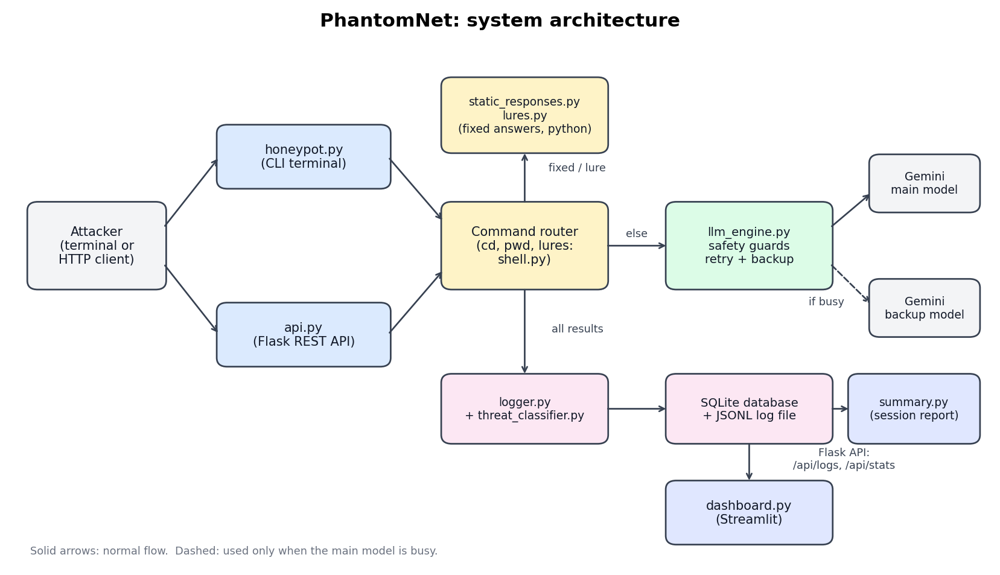
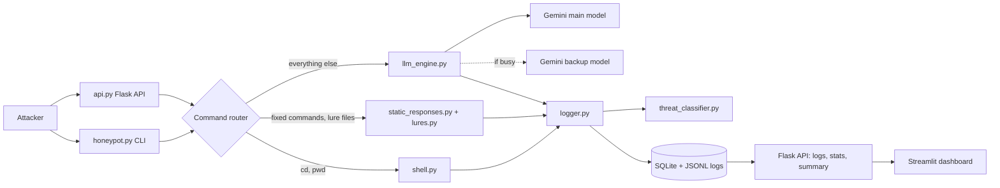

# PhantomNet: Generative Cyber-Deception (LLM Honeypot)

PhantomNet is a proof-of-concept honeypot. It looks like a Linux database server
(`prod-db-01`, Ubuntu 22.04, PostgreSQL 14) to anyone who types commands into it.
Answers are produced by a mix of fixed Python responses and a Gemini LLM.
Every command is logged, classified by attack type, and shown in a dashboard.

Built for the Infotact Solutions Generative AI internship (project ITS/GAI/1147).





## How it works

1. **Hybrid answers.** Commands with fixed output (`whoami`, `uname -a`, `cat /etc/passwd`)
   and the bait files are answered by Python, instantly and always the same.
   Everything else (`ps aux`, `wget`, `uptime`) is answered by Gemini.
2. **Lures.** `/root` holds invented bait files: `.pgpass`, `db_backup.sql`, `backup.sh`,
   `notes.txt`, `.bash_history`. All credentials and data are fake.
3. **Safety guards.** Prompt-injection attempts ("ignore previous instructions", "are you an AI")
   and any output that leaks AI wording are replaced with `command not found`.
   The API limits each session to 30 commands per minute and 500 in total.
4. **Reliability.** If the main Gemini model is busy, the engine retries and then
   switches to a backup model.
5. **Threat classifier.** Rule-based, tags each command as recon, credential_access,
   data_access, malware_download, persistence, privilege_escalation, exfiltration,
   destructive or other, with a severity.
6. **Logging and reports.** Events go to SQLite and a JSONL file. When a session ends,
   a short admin summary is produced.

## Files

| File | Purpose |
|---|---|
| `honeypot.py` | Terminal honeypot (local CLI) |
| `api.py` | Flask REST API around the same honeypot |
| `llm_engine.py` | Gemini calls, retry, backup model, safety guards |
| `shell.py` | `cd` handling and fake `ls` / `cat` for lure files |
| `lures.py` | Bait files and their metadata |
| `static_responses.py` | Fixed answers for static commands |
| `threat_classifier.py` | Command to attack category and severity |
| `logger.py`, `db.py` | JSONL and SQLite logging |
| `summary.py` | Per-session admin summary |
| `dashboard.py` | Streamlit dashboard (reads the API) |
| `evaluate.py`, `compare.py` | Evaluation runs and before/after table |
| `evaluation/` | Saved evaluation results |

## Setup

```
pip install -r requirements.txt
```

Copy `.env.example` to `.env` and put your Gemini API key in it. Never commit `.env`.

## Run

```
python honeypot.py                    # terminal honeypot
python api.py                         # Flask API on http://127.0.0.1:5000
python -m streamlit run dashboard.py  # dashboard (start the API first)
python evaluate.py --tag mytest       # evaluation, results go to evaluation/
python compare.py                     # before/after table
```

### API

| Method | Path | Description |
|---|---|---|
| POST | `/api/command` | Send `{"command": "...", "session_id": "..."}`, get the output |
| GET | `/api/logs?limit=100&session_id=...` | Recent events |
| GET | `/api/stats` | Totals by category, severity and source |
| GET | `/api/summary/<session_id>` | Session summary |
| GET | `/api/health` | Health check |

Example (PowerShell):

```
Invoke-RestMethod -Uri http://127.0.0.1:5000/api/command -Method Post -ContentType "application/json" -Body '{"command":"whoami"}'
```

## Evaluation

40 scripted attacker commands in 9 scenarios, run through the API code path with
`gemini-3.1-flash-lite`. "Before" is the LLM-only version for static commands,
"after" adds `static_responses.py`.

| Metric | Before | After |
|---|---|---|
| Answered by Python (no LLM) | 32.5% | 50.0% |
| Latency mean, all commands | 10.34 s | 2.10 s |
| Latency p95, all commands | 39.02 s | 14.13 s |
| Latency mean, LLM commands | 15.31 s | 4.15 s |
| Realism checks passed | 97.5% | 100.0% |
| Classifier accuracy | 100.0% | 100.0% |

Raw results are in `evaluation/`.

## Limitations

- **Proof of concept.** The honeypot runs locally (API bound to `127.0.0.1`). It is not a real
  SSH server and was not exposed to the internet or tested against real attackers.
- **Latency depends on Google's load.** The before/after run happened at different times, so the
  latency numbers are indicative only. LLM answers can still take several seconds, which a
  careful attacker could notice.
- **Small test set.** Realism and classifier scores come from 40 commands. The classifier rules
  were written with similar commands in mind, so 100% is not a general accuracy claim.
- **Automatic checks only.** Realism is checked with simple text rules, not by human judges.
- **Backup model has no chat history.** When it answers, it does not see earlier commands.
- **No pipes or scripts.** Commands with `|`, `>` or `;` are answered by the LLM and may be
  less consistent with the fake file system.

## Safety

Run this only on your own machine. Do not expose it to a public network. All credentials,
names and e-mail addresses in the bait files are invented. Logs may contain attacker input,
so they are excluded from git.